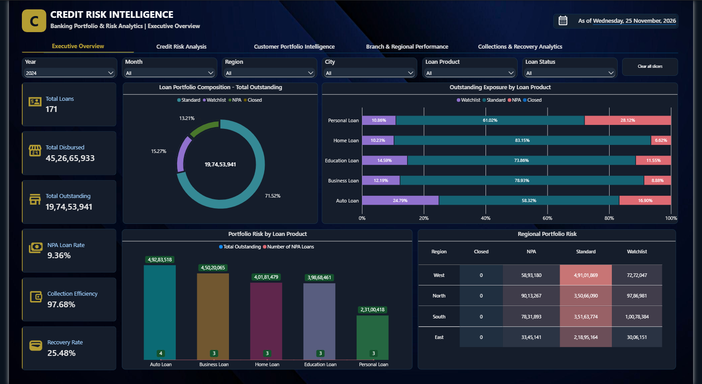
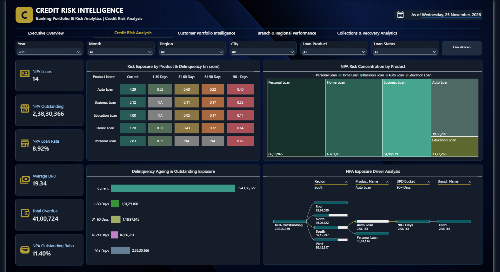
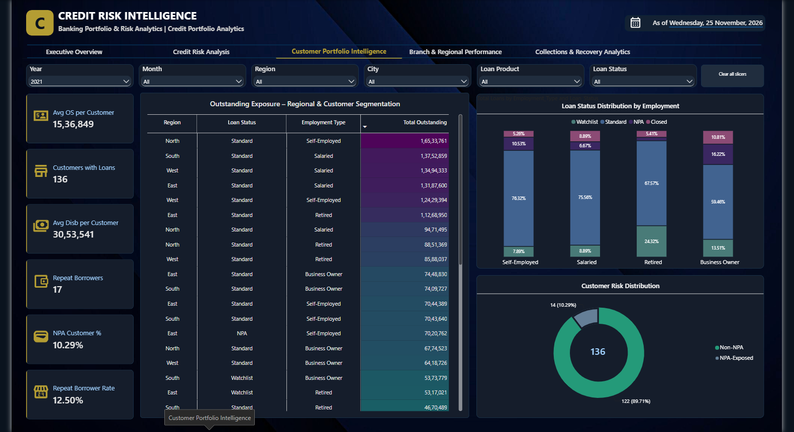
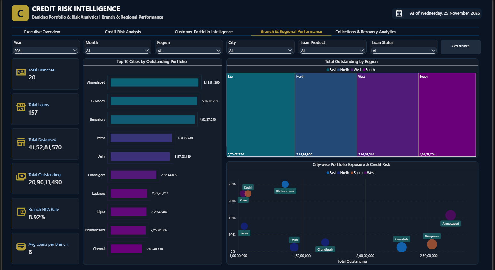
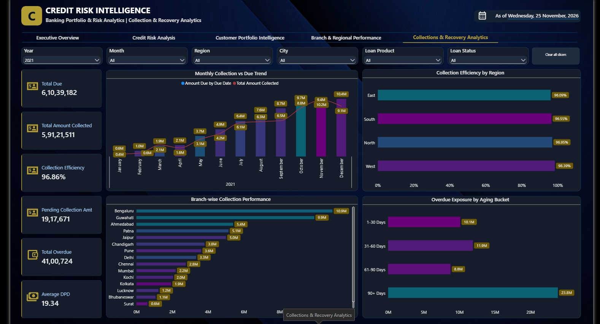

# Enterprise Banking – Credit Risk & Portfolio Intelligence Platform

## Project Overview

An enterprise-style Banking Analytics and Credit Risk Intelligence solution developed using Microsoft Power BI.

This project demonstrates the development of an end-to-end Business Intelligence solution for monitoring loan portfolios, identifying credit risk, analyzing customer behavior, evaluating branch performance, and tracking collections and recovery.

The solution simulates a real-world banking environment using entirely synthetic datasets.

## Business Objectives

- Monitor overall loan portfolio performance.
- Identify Non-Performing Assets (NPA) and high-risk loan segments.
- Analyze customer lending patterns and portfolio exposure.
- Evaluate branch and regional performance.
- Monitor collection efficiency and recovery performance.
- Support management decision-making through interactive dashboards.

## Technology Stack

| Technology | Purpose |
|---|---|
| Power BI Desktop | Interactive dashboards and reporting |
| DAX | Advanced business calculations and KPIs |
| Power Query | Data cleaning and transformation |
| Star Schema | Dimensional data modeling |
| Dynamic RLS | Branch-level data security |
| Incremental Refresh | Optimized data refresh configuration |

## Dashboard Modules

The solution contains five interactive dashboard pages:

1. Executive Overview
2. Credit Risk Analysis
3. Customer Portfolio Analytics
4. Branch & Regional Performance
5. Collections & Recovery Analytics

## Advanced Power BI Capabilities

- Star Schema data modeling
- Advanced DAX measures and calculations
- Dynamic Row-Level Security (RLS)
- Incremental Refresh configuration
- KPI-driven analytics
- Interactive filtering and page navigation
- Customer and portfolio risk segmentation
- Branch-level performance analysis

## Project Architecture

Synthetic Banking Datasets → Power Query Data Transformation → Star Schema Data Model → Advanced DAX Measures → Five Power BI Dashboards → Dynamic RLS & Incremental Refresh

## Data Disclaimer

All datasets used in this project are synthetic and created exclusively for demonstration and educational purposes.

No confidential, proprietary, or employer-owned data has been used.

## Copyright & Usage

© 2026. All rights reserved.

This is an independently developed portfolio project.

The original Power BI dashboard designs, project architecture, data models, DAX implementations, and documentation are protected by copyright.

Viewing this repository for learning and evaluation is permitted. Reproduction, redistribution, or commercial use of original project materials requires prior written permission.

## Author

**[Nitesh Das]**

Power BI Developer | Business Intelligence Consultant

Core Expertise:
- Enterprise Power BI Development
- Banking & Credit Risk Analytics
- Advanced DAX & Data Modeling
- Power Query & Data Transformation
- Dynamic Row-Level Security
- Dashboard Design & Performance Optimization

Professional Profile: [Coming soon]

---

## Dashboard Previews

The following dashboards provide an interactive view of the banking portfolio and credit risk analytics solution.

### 1. Executive Overview

### 2. Credit Risk Analysis

### 3. Customer Portfolio Analytics

### 4. Branch & Regional Performance

### 5. Collections & Recovery Analytics

---

# Data Architecture & Data Model

The project follows a dimensional data modeling approach designed to support enterprise banking analytics and credit risk reporting.

## Data Model Architecture

The architecture consists of:

- 3 Fact Tables
- 4 Dimension Tables
- 4 Supporting Tables
- Shared dimensions for consistent analytical reporting
- Dynamic Row-Level Security (RLS)

## Fact Tables

| Table | Description |
|---|---|
| Fact_Loan | Loan disbursement and outstanding portfolio data |
| Fact_Payment | Payment transactions and repayment information |
| Fact_Collections | Collections and recovery activities |

## Dimension Tables

| Table | Description |
|---|---|
| Dim_Customer | Customer demographic and income information |
| Dim_Branch | Branch and regional information |
| Dim_Product | Loan product information |
| Dim_Calendar | Centralized date dimension |

## Supporting Tables

- A_Measure
- Portfolio_Performance
- Customer_Risk_Segment
- SecurityAccess

## Technical Documentation

Detailed technical documentation is available below:

- [Data Model Overview](03_Data_Model/README.md)
- [Table Relationships](03_Data_Model/Table_Relationships.md)
- [Table Dictionary](03_Data_Model/Table_Dictionary.md)
- [Data Model Diagram](03_Data_Model/Data_Model_Diagram.png)
- [Dynamic RLS Documentation](05_RLS_Security/README.md)
- [Project Documentation](06_Project_Documentation/README.md)

## Data Governance

- Synthetic banking datasets only.
- Dynamic Row-Level Security implementation.
- Shared dimensional architecture.
- Active and inactive date relationships.
- Centralized DAX measure management.

---

**Project Note:** This solution was developed using Microsoft Power BI Desktop, Power Query, DAX, and Star Schema data modeling. All banking data is synthetic and intended exclusively for demonstration and portfolio purposes.

